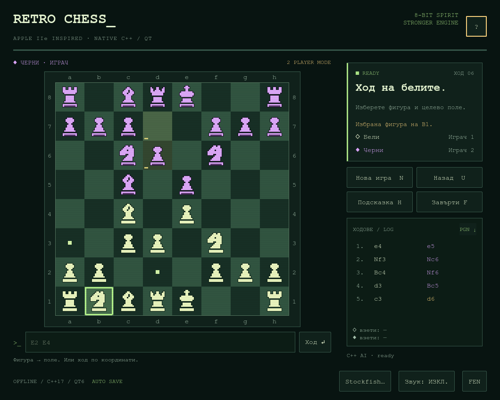

<div align="center">

# Retro Chess

**A standalone retro chess game in C++ / Qt 6** — pixel art inspired by the Apple IIe
and the Sargon II/III era.

[](LICENSE)
[](https://www.qt.io/)
[](https://isocpp.org/)



</div>

---

A complete desktop chess game written from scratch in C++ with Qt 6 Widgets.
No board library, no chess framework — the rules, SAN/FEN handling and the search
engine are all in `src/`. The look is deliberately period-accurate: hand-drawn
bitmap sprites, a monospace UI and an 8-bit status line.

This is **not** a real Apple IIe program and it uses **no code or artwork from
Sargon**. It is an original homage to that era.

## Status

| Platform | Toolchain | Result |
|---|---|---|
| Linux | GCC, Qt 6.10.1 | builds, all tests pass |
| Windows | MSYS2, GCC 15.2, Qt 6.11.0 | builds, all tests pass |
| macOS | configuration included | not built here |

## Features

- Full rules: castling, en passant, promotion to all four pieces, check, mate,
  stalemate, insufficient material.
- Threefold repetition and the fifty-move rule are **detected automatically** and
  scored as a draw — there is no separate claim action.
- Built-in C++ engine on its own thread: iterative deepening, PVS / alpha-beta,
  transposition table, quiescence search, killer/history ordering and late-move
  reductions, with a tapered midgame/endgame evaluation.
- Optional **Stockfish / UCI** backend for much stronger play.
- PGN export, FEN copy/paste, undo, hints, board flip, and two-player or
  computer modes.
- Auto-save to a local `game.json` in the platform's application-data directory,
  written atomically via `QSaveFile` and restored on next launch.
- Pixel-art UI in Bulgarian and English.

## Build

### Qt Creator

1. Install Qt 6.2 or newer, Qt Creator and a Desktop compiler from
   [qt.io/download-qt-installer-oss](https://www.qt.io/download-qt-installer-oss).
2. Open `CMakeLists.txt`, pick your Desktop kit and the **Release** configuration.
3. Build and run.

The compiler and the Qt kit must match (MinGW with MinGW Qt, MSVC with MSVC Qt).

### MSYS2 on Windows (no Visual Studio required)

```sh
pacman -S --needed mingw-w64-x86_64-{toolchain,qt6-base,qt6-tools}

cmake -S . -B build -G Ninja -DCMAKE_BUILD_TYPE=Release
cmake --build build --parallel
ctest --test-dir build --output-on-failure
```

To produce a folder that runs on a machine without Qt or MSYS2:

```sh
cd build && windeployqt6 --release --no-translations RetroChess.exe
```

`windeployqt6` does not copy the MinGW runtime libraries. Add `libgcc_s_seh-1.dll`,
`libstdc++-6.dll` and `libwinpthread-1.dll` from `/mingw64/bin` manually, otherwise
the executable fails to start.

> **Note on the Qt installer:** it ships only MinGW 8.1 under `C:\Qt\Tools`, while
> the Qt 6.6+ `mingw_64` binaries are built with a much newer GCC. That combination
> does not compile (`<filesystem>` breaks). Either use the Qt from MSYS2, where GCC
> and Qt come from the same distribution, or install a matching MinGW via the
> Maintenance Tool.

### Plain command line

```sh
cmake -S . -B build -DCMAKE_BUILD_TYPE=Release
cmake --build build --config Release --parallel
ctest --test-dir build -C Release --output-on-failure
```

Game only, no tests:

```sh
cmake -S . -B build -DCMAKE_BUILD_TYPE=Release -DBUILD_TESTING=OFF
cmake --build build --config Release --parallel
```

The binary is `build/RetroChess`, `build/RetroChess.exe`, or `build/RetroChess.app`.

## Engine strength

The built-in engine has five levels:

| Level | Max depth | Target search time |
|---|---:|---:|
| 1 | 3 | 0.18 s |
| 2 | 5 | 0.65 s |
| 3 — default | 7 | 1.6 s |
| 4 | 9 | 3.5 s |
| 5 | 12 | 6.5 s |

Depth is an upper bound, not a guarantee, and the achieved depth depends on the CPU
and the position. **The levels are not Elo ratings and no tournament strength has been
measured.**

### Stockfish / UCI

For significantly stronger play, download Stockfish from
[stockfishchess.org/download](https://stockfishchess.org/download/), unpack it, then
press **"Stockfish…"** in the game and pick the executable (or set it under
**New game → Engine: Stockfish / UCI → File…**). Use level 5 for the maximum
`Skill Level = 20`.

Stockfish is also found on `PATH`, next to the game executable, or in an `engines/`
folder next to it. No binary or neural network is bundled in this repository. The UCI
connection is verified against official Stockfish 17.1. If the external engine cannot
start or returns an illegal move, the game falls back to the built-in engine and says so.

The footer button always names the engine that is currently active — `C++ AI ▾` or
`Stockfish ▾`. Open it to pick the other one. Switching is immediate and **does not
restart the game**: a running search is cancelled and the built-in engine simply takes
the next turn, or the chosen engine does.

## Controls

- **Mouse:** click your piece, then the target square.
- **Keyboard:** arrows on the board select a square, `Enter` / `Space` selects or moves.
- **Move field:** type `E2 E4` and press `Enter`. Promotion: `E7 E8 Q` / `R` / `B` / `N`.
- `N` new game, `U` undo, `H` hint, `F` flip, `Esc` cancel selection, `?` / `F1` help.
- In two-player mode, *Undo* steps back one move. Against the computer it reverts your
  move and the reply, and can interrupt the current search.
- A hint marks the move without playing it.

The king has a **cross**, the queen a **crown**. The white king starts on **e1, a dark
square**; the queen on **d1, a light square**. h1 is light. *Flip* only changes the
viewpoint.

## Reproducible screenshot

```sh
build/RetroChess --qa-state midgame --screenshot preview.png
```

## Tests

```sh
ctest --test-dir build -C Release --output-on-failure
```

Covers perft from the initial position to depth 4, Kiwipete to depth 3, tricky
en-passant and promotion positions, SAN, mate, stalemate, draws, mouse and keyboard
input, dialogs, the engine thread, hints, undo during search, UCI, an invalid UCI
file and the fallback engine.

## Layout

```
src/chess.*          rules, SAN/FEN, position validation
src/search.*         built-in C++ engine
src/enginebridge.*   Stockfish / UCI and the fallback path
src/boardwidget.*    the board and original pixel sprites
src/mainwindow.*     UI, save game and settings
tests/               rule, engine and UI tests
docs/                screenshots and test reports
```

## License

The project's own code is released under the **MIT License** — see [LICENSE](LICENSE).

Qt is licensed separately, and Stockfish is a separate GPLv3 engine under its own
license. Neither license is replaced by this project's license. Respect the Qt license
when you redistribute binaries that bundle its libraries.